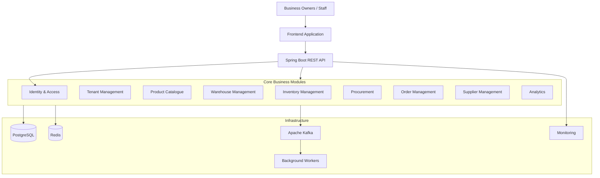
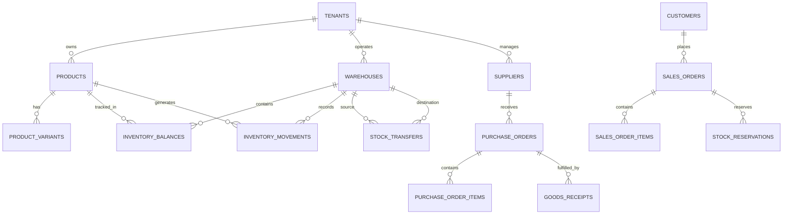
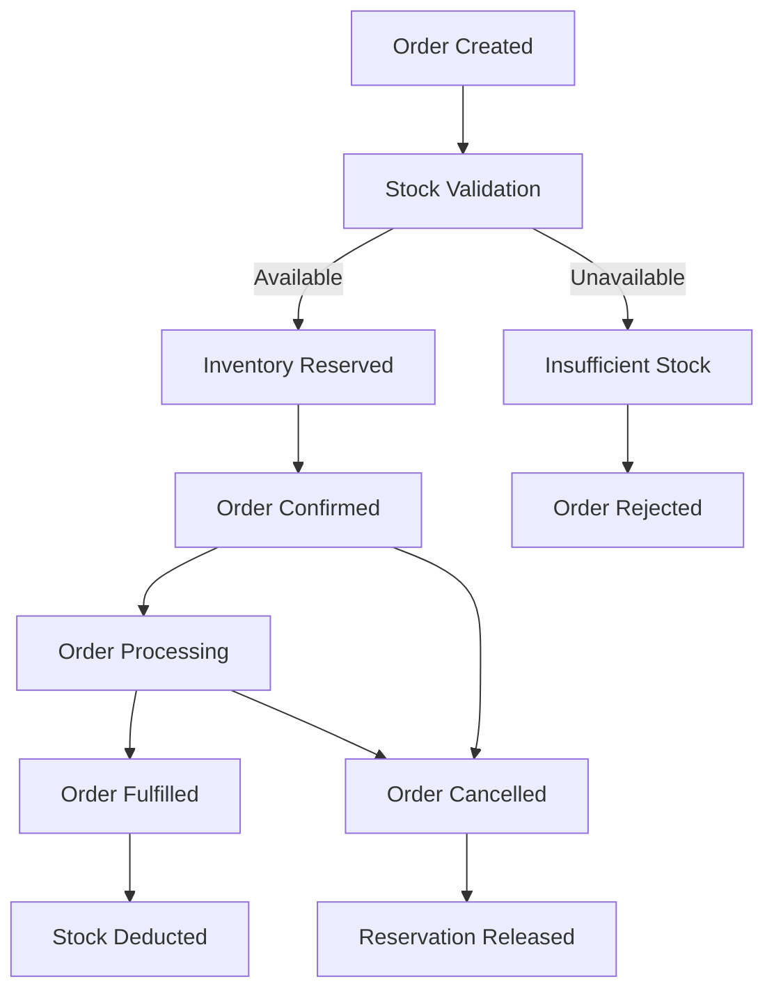
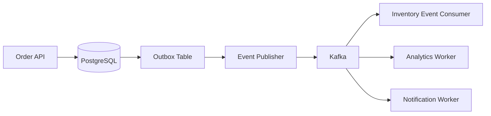
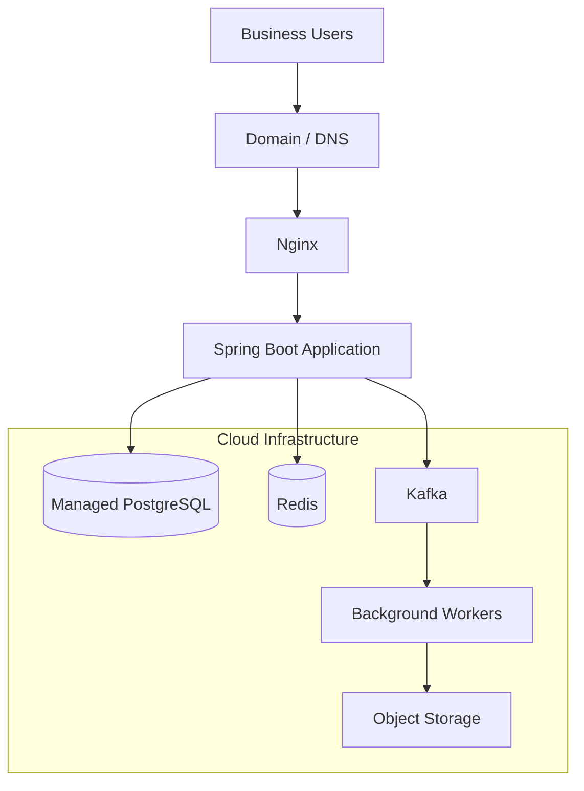

# StockPilot — Inventory, Procurement & Order Management SaaS

> **A unified platform to manage inventory, warehouses, procurement, suppliers, and order fulfillment.**

StockPilot is a multi-tenant inventory and order management platform designed for small and medium-sized retailers, wholesalers, distributors, and businesses that need better control over their inventory operations.

The platform provides a centralized workspace to manage products, stock levels, warehouses, suppliers, purchase orders, sales orders, inventory movements, and business analytics.

Businesses can track stock across multiple locations, manage procurement workflows, monitor inventory changes, and process orders while maintaining accurate inventory records.

The project is being developed with a focus on **backend engineering, transactional consistency, concurrency control, database optimization, event-driven architecture, distributed processing, and production-ready software practices.**

---

## Table of Contents

- [1. Problem Statement](#1-problem-statement)
- [2. Proposed Solution](#2-proposed-solution)
- [3. Target Users](#3-target-users)
- [4. Key Features](#4-key-features)
- [5. User Roles and Permissions](#5-user-roles-and-permissions)
- [6. System Architecture](#6-system-architecture)
- [7. Technology Stack](#7-technology-stack)
- [8. Backend Architecture](#8-backend-architecture)
- [9. Database Design](#9-database-design)
- [10. Inventory Management and Consistency](#10-inventory-management-and-consistency)
- [11. Order Processing Workflow](#11-order-processing-workflow)
- [12. Event-Driven Architecture](#12-event-driven-architecture)
- [13. API Design](#13-api-design)
- [14. Security](#14-security)
- [15. Testing Strategy](#15-testing-strategy)
- [16. Deployment and DevOps](#16-deployment-and-devops)
- [17. Observability and Reliability](#17-observability-and-reliability)
- [18. Project Structure](#18-project-structure)
- [19. Development Roadmap](#19-development-roadmap)
- [20. Local Development Setup](#20-local-development-setup)
- [21. Environment Variables](#21-environment-variables)
- [22. Engineering Challenges](#22-engineering-challenges)
- [23. Future Enhancements](#23-future-enhancements)
- [24. Contributing](#24-contributing)

---

## 1. Problem Statement

Many small and medium-sized businesses manage inventory using spreadsheets, manual registers, disconnected billing systems, or basic stock management applications.

As businesses grow, these approaches create operational problems:

- Inaccurate stock quantities across different locations.
- Difficulty tracking incoming and outgoing inventory.
- Overselling products due to concurrent orders.
- Manual purchase order creation and supplier coordination.
- Poor visibility into stock movement history.
- Difficulty identifying low-stock and fast-moving products.
- No centralized warehouse management.
- Inconsistent inventory updates after returns and cancellations.
- Limited reporting and operational insights.
- Lack of accountability for inventory adjustments.

Businesses operating across multiple warehouses face additional challenges because inventory must remain accurate across locations while orders and stock transfers happen simultaneously.

StockPilot aims to solve these problems through a centralized inventory and procurement management platform.

## 2. Proposed Solution

StockPilot provides businesses with a unified platform to manage their complete inventory lifecycle.

Each business receives an isolated workspace with its own products, warehouses, suppliers, employees, purchase orders, sales orders, and inventory records.

### How it works

1. A business registers and creates its workspace.
2. The business configures warehouses and storage locations.
3. Products and SKUs are added to the product catalogue.
4. Suppliers are registered and associated with products.
5. Purchase orders are created to replenish stock.
6. Incoming inventory is received and recorded.
7. Customers' orders reserve available inventory.
8. Fulfilled orders update inventory quantities.
9. Returns and adjustments are recorded through controlled workflows.
10. Business owners monitor stock levels and operational performance.

### Product objectives

- Maintain accurate inventory records.
- Simplify procurement and supplier management.
- Support multiple warehouses.
- Prevent overselling and inconsistent stock updates.
- Provide traceability for inventory movements.
- Improve order fulfillment workflows.
- Give businesses actionable inventory insights.

---

## 3. Target Users

StockPilot is designed for businesses that need centralized inventory control.

| Business category | Example use case |
|---|---|
| Retail stores | Track product availability and sales |
| Wholesalers | Manage bulk inventory and orders |
| Distributors | Coordinate warehouse stock and fulfillment |
| E-commerce businesses | Track stock and prevent overselling |
| Grocery stores | Monitor product quantities and expiry |
| Electronics retailers | Manage product SKUs and serial numbers |
| Manufacturers | Track raw materials and finished goods |
| Small businesses | Replace spreadsheet-based stock management |

The initial focus is small and medium-sized businesses that need practical inventory management without the complexity of large enterprise resource planning systems.

---

## 4. Key Features

The following describes the intended product scope. Features will be marked as implemented as development progresses.

### 4.1 Multi-Tenant Business Management

- Business registration and workspace creation.
- Independent business configurations.
- Tenant-level data isolation.
- Workspace-specific inventory.
- Organization-level staff management.
- Business settings and preferences.
- Tenant-specific operational reports.

### 4.2 Product and SKU Management

Businesses can create and manage their product catalogue.

Each product can include:

- Product name and description.
- SKU (Stock Keeping Unit).
- Barcode.
- Product category.
- Brand and manufacturer.
- Unit of measurement.
- Cost price.
- Selling price.
- Reorder threshold.
- Product status.
- Product variants.

Products may have multiple variants, such as different sizes, colors, or packaging types.

### 4.3 Warehouse Management

StockPilot will support multiple warehouses under one business workspace.

Features:

- Create and manage warehouses.
- Maintain warehouse addresses and details.
- Track stock independently by warehouse.
- View warehouse-wise availability.
- Transfer stock between warehouses.
- Maintain warehouse inventory history.
- Restrict warehouse access based on permissions.

### 4.4 Inventory Management

Inventory management is the central domain of StockPilot.

Features:

- Real-time stock quantity tracking.
- Incoming and outgoing inventory.
- Stock adjustments.
- Reserved inventory.
- Available-to-sell quantity.
- Low-stock alerts.
- Inventory movement history.
- Warehouse-wise stock reports.
- Stock reconciliation.

Inventory quantities will be maintained through controlled business operations rather than arbitrary direct updates.

### 4.5 Supplier Management

Businesses can maintain supplier information and procurement relationships.

Features:

- Supplier registration.
- Contact and business information.
- Supplier product associations.
- Purchase history.
- Supplier status.
- Purchase order tracking.
- Supplier-wise procurement reports.

### 4.6 Procurement and Purchase Orders

Businesses can create purchase orders to replenish inventory.

Purchase order workflow:

1. Select a supplier.
2. Add products and quantities.
3. Review estimated purchase costs.
4. Create a purchase order.
5. Send or record the order with the supplier.
6. Track order status.
7. Receive inventory.
8. Update stock after successful receipt.

Planned purchase order statuses:

- DRAFT
- SUBMITTED
- APPROVED
- PARTIALLY_RECEIVED
- RECEIVED
- CANCELLED

### 4.7 Goods Receipt Management

When inventory arrives from a supplier, businesses can record the received quantities.

Features:

- Record goods received against a purchase order.
- Support partial deliveries.
- Validate received quantities.
- Track damaged or missing items.
- Record receipt timestamps.
- Update warehouse inventory.
- Maintain a goods receipt history.

A purchase order should not automatically increase stock merely because it was created. Inventory should increase only after a valid goods receipt is recorded.

### 4.8 Sales Order Management

Businesses can manage customer orders through a structured order lifecycle.

Features:

- Create customer orders.
- Add products and quantities.
- Validate stock availability.
- Reserve inventory.
- Track order status.
- Process fulfillment.
- Record cancellations.
- Manage returns.
- Maintain order history.

### 4.9 Inventory Reservations

StockPilot will distinguish between physical stock and stock available for new orders.

Example:

```text
Physical Stock:       100
Reserved Stock:        25
Available Stock:       75
```

When a customer order is placed, eligible inventory is reserved.

When an order is fulfilled, the physical stock is reduced and the reservation is released.

When an order is cancelled, its reservation is released so that the stock becomes available again.

### 4.10 Stock Transfers

Businesses can move inventory between warehouses.

Features:

- Create transfer requests.
- Select source and destination warehouses.
- Specify product quantities.
- Track transfer status.
- Record dispatch.
- Confirm receiving quantities.
- Handle partial transfers.
- Maintain transfer history.

The system will ensure that stock is not incorrectly counted in both warehouses during a transfer.

### 4.11 Batch and Expiry Tracking

For businesses that handle perishable or expiry-sensitive products, StockPilot will support:

- Batch numbers.
- Manufacturing dates.
- Expiry dates.
- Batch-wise quantities.
- Expiry alerts.
- Batch-level stock movement.
- First-expiry-first-out (FEFO) allocation where appropriate.

### 4.12 Low-Stock Alerts

The system will identify products whose available quantity falls below configured reorder thresholds.

Planned capabilities:

- Product-level reorder thresholds.
- Warehouse-specific thresholds.
- Low-stock dashboard.
- Replenishment suggestions.
- Notification workflows.
- Stockout reporting.

### 4.13 Business Analytics

Business owners will have access to operational reports.

Planned metrics:

- Total products.
- Total inventory value.
- Available and reserved stock.
- Low-stock products.
- Out-of-stock products.
- Purchase order volume.
- Sales order volume.
- Warehouse-wise inventory.
- Fast-moving products.
- Slow-moving products.
- Inventory turnover.
- Stock adjustment history.

---

## 5. User Roles and Permissions

StockPilot will use role-based access control.

| Role | Responsibilities |
|---|---|
| Platform Administrator | Platform-level administration |
| Business Owner | Complete workspace management |
| Inventory Manager | Manage stock and inventory operations |
| Warehouse Manager | Manage assigned warehouse operations |
| Procurement Manager | Manage suppliers and purchase orders |
| Sales Staff | Create and manage customer orders |
| Viewer | Read-only access to permitted information |

### Authorization principles

- Users can access only authorized business workspaces.
- Warehouse managers can be restricted to assigned warehouses.
- Procurement permissions are separated from inventory adjustment permissions.
- Sensitive inventory adjustments are recorded.
- Business ownership is validated on the backend.
- Tenant identifiers supplied by clients are never trusted as authorization proof.

---

## 6. System Architecture

StockPilot will initially use a modular monolith architecture.

The application will be divided into business modules with explicit responsibilities and well-defined boundaries.

As workload grows, independent workers and services can be extracted where operational requirements justify them.

### High-level architecture



### Architecture principles

- Modular business domains.
- Clear separation of concerns.
- Transactional consistency.
- Tenant-level data isolation.
- Controlled inventory state transitions.
- Asynchronous processing for non-critical operations.
- Centralized validation and exception handling.
- Consistent API contracts.
- Infrastructure-independent business logic.

---

## 7. Technology Stack

The following is the intended technology stack.

| Category | Technology | Purpose |
|---|---|---|
| Language | Java 21 | Backend development |
| Framework | Spring Boot | Application framework |
| Web | Spring MVC | REST API development |
| Security | Spring Security | Authentication and authorization |
| Persistence | Spring Data JPA, Hibernate | Database interaction |
| Database | PostgreSQL | Transactional storage |
| Cache | Redis | Caching and coordination |
| Messaging | Apache Kafka | Event-driven processing |
| Batch Processing | Spring Batch | Bulk operations and reconciliation |
| Build | Maven | Build and dependency management |
| API Documentation | Swagger / OpenAPI | API documentation |
| Testing | JUnit 5, Mockito | Automated testing |
| Integration Testing | Testcontainers | Real infrastructure testing |
| API Testing | REST Assured | API verification |
| Containers | Docker, Docker Compose | Containerization |
| Cloud | AWS | Infrastructure and deployment |
| CI/CD | GitHub Actions | Automated build and delivery |
| Reverse Proxy | Nginx | Routing and proxy management |
| Monitoring | Prometheus, Grafana | Metrics and observability |
| Version Control | Git, GitHub | Source control |

### Technology selection rationale

**Java and Spring Boot:** Provide a mature environment for building maintainable enterprise backend applications.

**PostgreSQL:** Supports relational data, transactions, constraints, indexing, and consistent inventory operations.

**Redis:** Supports caching and selected coordination workflows.

**Kafka:** Supports asynchronous inventory and order events.

**Spring Batch:** Supports large imports, scheduled reconciliation, and bulk inventory processing.

**Docker:** Makes development and deployment environments reproducible.

**AWS:** Provides infrastructure for hosting and operating the application.

Technologies will be introduced according to actual product requirements.

---

## 8. Backend Architecture

The backend will be organized into independent business modules.

| Module | Responsibility |
|---|---|
| Identity | User registration and authentication |
| Tenant | Business workspace management |
| Authorization | Roles and permissions |
| Product | Product catalogue and SKU management |
| Warehouse | Warehouse and location management |
| Inventory | Stock quantities and inventory movements |
| Procurement | Purchase orders and goods receipts |
| Supplier | Supplier management |
| Orders | Sales order lifecycle |
| Reservation | Inventory reservation and release |
| Transfer | Inter-warehouse stock transfers |
| Notification | Alerts and notification workflows |
| Analytics | Inventory and operational reporting |
| Audit | Historical operation records |

### Layered design

```text
Controller Layer
       |
       v
Service Layer
       |
       v
Repository Layer
       |
       v
PostgreSQL
```

Supporting components:

- DTOs for API requests and responses.
- Entities for persistence.
- Validators for business rules.
- Mappers for object conversion.
- Centralized exception handling.
- Transaction boundaries.
- Domain events.
- Security filters and authorization components.

### Engineering principles

- SOLID principles.
- Dependency injection.
- Repository and service patterns.
- Explicit transaction boundaries.
- Domain-oriented design.
- Separation of read and write responsibilities where useful.
- Reusable validation logic.
- Avoiding unnecessary coupling.

---

## 9. Database Design

PostgreSQL will be the primary transactional database.

The data model will maintain traceability between products, warehouses, inventory movements, suppliers, purchase orders, and customer orders.

### Planned core entities

| Entity | Purpose |
|---|---|
| users | Registered platform users |
| tenants | Business workspaces |
| tenant_memberships | User-to-business relationships |
| roles | Application roles |
| permissions | Permission definitions |
| products | Product catalogue |
| product_variants | Product variations |
| categories | Product categories |
| warehouses | Business warehouses |
| warehouse_memberships | Staff warehouse assignments |
| inventory_balances | Current stock balances |
| inventory_movements | Stock movement history |
| suppliers | Supplier information |
| supplier_products | Supplier-product relationships |
| purchase_orders | Procurement orders |
| purchase_order_items | Purchase order line items |
| goods_receipts | Received inventory records |
| goods_receipt_items | Received quantities |
| customers | Customer records |
| sales_orders | Customer sales orders |
| sales_order_items | Ordered products and quantities |
| stock_reservations | Reserved inventory |
| stock_transfers | Warehouse transfer records |
| stock_transfer_items | Transfer line items |
| product_batches | Batch and expiry information |
| notifications | Notification tracking |
| audit_logs | Historical business activities |

### Example relationship model



### Database engineering practices

- Primary and foreign key constraints.
- Tenant-aware unique constraints.
- Appropriate database normalization.
- Indexing for frequently queried fields.
- Pagination for large datasets.
- Versioned database migrations.
- Transaction management.
- Connection pooling.
- Query optimization.
- Audit and historical records.

### Inventory data model

The system will distinguish between:

- Physical quantity.
- Reserved quantity.
- Available quantity.
- Incoming quantity.
- Damaged or quarantined quantity.

A conceptual calculation:

```text
Available Stock = Physical Stock - Reserved Stock
```

The final inventory model will account for the status of goods, warehouse location, and applicable business rules.

Inventory movement history will provide an auditable record of why stock changed.

---

## 10. Inventory Management and Consistency

Inventory consistency is one of the most important engineering challenges in StockPilot.

### The problem

Consider a warehouse with 10 units of a product.

Two customers simultaneously place orders for 7 units each.

If both requests read the initial stock quantity before either update is committed, the system could accept both orders.

This would result in 14 units being promised despite only 10 being available.

### Proposed solution

StockPilot will use transactional inventory operations.

A simplified reservation workflow:

1. Receive an order request.
2. Validate the product and warehouse.
3. Start a database transaction.
4. Lock or safely update the inventory balance.
5. Calculate the available quantity.
6. Reject the operation if insufficient stock exists.
7. Create the reservation.
8. Update the reserved quantity.
9. Commit the transaction.

### Concurrency control techniques

- Database transactions.
- Optimistic locking using entity versions where suitable.
- Pessimistic row-level locking for critical stock operations.
- Atomic conditional updates.
- Unique constraints.
- Idempotency keys.
- Transaction isolation appropriate to the operation.

### Example conditional stock update

```sql
UPDATE inventory_balances
SET reserved_quantity = reserved_quantity + :quantity,
    version = version + 1
WHERE product_id = :productId
  AND warehouse_id = :warehouseId
  AND physical_quantity - reserved_quantity >= :quantity;
```

The application must verify that the update affected exactly one row before confirming the reservation.

### Expected behavior

If two requests compete for insufficient stock, the system must accept only operations that satisfy the inventory constraints.

The frontend must never be responsible for guaranteeing stock consistency.

---

## 11. Order Processing Workflow

StockPilot will maintain explicit order states and controlled transitions.

### Sales order lifecycle



### Planned order statuses

- DRAFT
- PENDING
- CONFIRMED
- PROCESSING
- FULFILLED
- CANCELLED
- REJECTED
- RETURNED

The allowed transitions will be validated by the backend.

### Order cancellation

When an eligible order is cancelled:

1. Validate the current order status.
2. Start a transaction.
3. Release its inventory reservation.
4. Update the order status.
5. Record the cancellation.
6. Publish the relevant event.

### Returns

Returned inventory will not automatically become available for sale.

The business must record the received condition of returned goods.

Possible outcomes:

- Restock.
- Damaged.
- Quarantined.
- Sent for inspection.

This prevents returned or damaged products from being incorrectly counted as sellable inventory.

---

## 12. Event-Driven Architecture

StockPilot will use Apache Kafka for asynchronous communication between business workflows.

### Planned domain events

- ProductCreated
- InventoryReceived
- InventoryAdjusted
- StockReserved
- StockReleased
- OrderCreated
- OrderConfirmed
- OrderFulfilled
- OrderCancelled
- PurchaseOrderCreated
- GoodsReceiptCompleted
- StockTransferCompleted
- LowStockDetected

### Example event flow



### Reliability considerations

- Transactional outbox pattern.
- Idempotent event consumers.
- Retry mechanisms.
- Dead-letter handling.
- Duplicate event detection.
- Event schema versioning.
- Consumer lag monitoring.
- Failure tracking.

### Why asynchronous processing?

Some operations should not delay the primary inventory transaction.

For example, when an order is confirmed, the system should not wait for analytics calculations or email notifications to finish.

Those operations can be processed independently after the business transaction succeeds.

---

## 13. API Design

StockPilot will expose versioned REST APIs.

API documentation will be maintained through OpenAPI and Swagger UI.

### Planned API groups

| Module | Endpoint examples |
|---|---|
| Authentication | `/api/v1/auth/register`, `/api/v1/auth/login` |
| Tenants | `/api/v1/tenants` |
| Products | `/api/v1/tenants/{tenantId}/products` |
| Categories | `/api/v1/tenants/{tenantId}/categories` |
| Warehouses | `/api/v1/tenants/{tenantId}/warehouses` |
| Inventory | `/api/v1/tenants/{tenantId}/inventory` |
| Movements | `/api/v1/tenants/{tenantId}/inventory/movements` |
| Suppliers | `/api/v1/tenants/{tenantId}/suppliers` |
| Purchase Orders | `/api/v1/tenants/{tenantId}/purchase-orders` |
| Goods Receipts | `/api/v1/tenants/{tenantId}/goods-receipts` |
| Sales Orders | `/api/v1/tenants/{tenantId}/orders` |
| Reservations | `/api/v1/tenants/{tenantId}/reservations` |
| Transfers | `/api/v1/tenants/{tenantId}/transfers` |
| Analytics | `/api/v1/tenants/{tenantId}/analytics` |

These are proposed endpoint examples. The final API contract may evolve during implementation.

### API conventions

- Versioned routes.
- DTO-based request and response models.
- Input validation.
- Consistent HTTP status codes.
- Pagination and sorting.
- Centralized error responses.
- Authentication and authorization.
- OpenAPI documentation.

### Example inventory response

```json
{
  "success": true,
  "message": "Inventory retrieved successfully",
  "data": {
    "productSku": "SKU-1001",
    "warehouseId": "WH-001",
    "physicalQuantity": 100,
    "reservedQuantity": 25,
    "availableQuantity": 75
  }
}
```

### Example insufficient stock response

```json
{
  "success": false,
  "message": "Insufficient inventory available",
  "errorCode": "INSUFFICIENT_STOCK"
}
```

---

## 14. Security

StockPilot handles commercially sensitive information such as inventory levels, supplier details, purchasing records, and customer orders.

Security will be incorporated into the architecture.

### Planned security controls

- Spring Security.
- JWT-based authentication.
- Secure password hashing.
- Role-based access control.
- Tenant-level data isolation.
- Warehouse-level authorization.
- Request validation.
- Parameterized database operations.
- CORS configuration.
- Rate limiting.
- Secure secret management.
- Audit logging.
- Dependency vulnerability checks.

### Important authorization scenarios

- A user from one business cannot access another business's products.
- A warehouse manager cannot access unauthorized warehouses.
- Sales staff cannot perform restricted inventory adjustments.
- Procurement staff cannot change unrelated business settings.
- Sensitive operations require appropriate permissions.

### OWASP considerations

Development will consider common web application security risks, including:

- Broken access control.
- Injection.
- Authentication failures.
- Security misconfiguration.
- Insecure design.
- Vulnerable dependencies.

---

## 15. Testing Strategy

Testing will cover business logic, transactional consistency, authorization, and failure scenarios.

| Test type | Tools | Purpose |
|---|---|---|
| Unit testing | JUnit 5 | Validate business logic |
| Mock-based testing | Mockito | Isolate service dependencies |
| Integration testing | Spring Boot Test | Validate component integration |
| Database testing | Testcontainers | Test with real PostgreSQL |
| API testing | REST Assured | Verify API behavior |
| Security testing | Spring Security Test | Validate permissions |
| Concurrency testing | JUnit and concurrent clients | Verify stock consistency |
| Event testing | Kafka test infrastructure | Verify asynchronous processing |

### Critical test scenarios

- Product creation and SKU uniqueness.
- Warehouse creation.
- Tenant data isolation.
- Stock receipt.
- Purchase order partial fulfillment.
- Inventory reservation.
- Concurrent stock reservations.
- Insufficient stock rejection.
- Order cancellation and stock release.
- Duplicate order requests.
- Warehouse transfer.
- Partial stock transfer.
- Damaged goods handling.
- Duplicate event processing.
- Event consumer failure and retry.
- Inventory reconciliation.

Testing will focus on correctness and failure handling, not just code coverage.

---

## 16. Deployment and DevOps

The deployment strategy will support repeatable builds and consistent environments.

### Planned deployment architecture



### Planned DevOps practices

- Dockerized application.
- Docker Compose for local infrastructure.
- Environment-specific configuration.
- Maven build automation.
- GitHub Actions workflows.
- Automated test execution.
- Container image creation.
- Cloud deployment.
- HTTPS configuration.
- Database migrations.
- Health checks.

### AWS services under consideration

| AWS service | Intended use |
|---|---|
| EC2 | Application hosting |
| RDS | Managed PostgreSQL |
| S3 | Product files and exports |
| IAM | Infrastructure access management |
| CloudWatch | Application and infrastructure logs |
| Lambda | Optional event-driven tasks |

The final deployment architecture will be selected based on cost, workload, and operational requirements.

---

## 17. Observability and Reliability

StockPilot will incorporate observability to make inventory operations and system failures diagnosable.

Planned capabilities:

- Structured application logging.
- Request correlation IDs.
- Health and readiness endpoints.
- API response-time metrics.
- Database connection monitoring.
- Slow query monitoring.
- Inventory operation metrics.
- Background job failure tracking.
- Kafka consumer lag monitoring.
- Prometheus metrics.
- Grafana dashboards.

### Reliability goals

- Prevent negative available stock.
- Preserve inventory movement history.
- Avoid duplicate order processing.
- Make stock reservations recoverable.
- Handle partial purchase receipts.
- Maintain correct transfer accounting.
- Track failed asynchronous operations.
- Support reconciliation when records become inconsistent.

---

## 18. Project Structure

The backend will follow a modular package structure.

An example planned structure:

```text
stockpilot/
│
├── backend/
│   ├── src/
│   │   ├── main/
│   │   │   ├── java/com/stockpilot/
│   │   │   │   ├── StockPilotApplication.java
│   │   │   │   │
│   │   │   │   ├── common/
│   │   │   │   │   ├── config/
│   │   │   │   │   ├── exception/
│   │   │   │   │   ├── response/
│   │   │   │   │   └── security/
│   │   │   │   │
│   │   │   │   ├── identity/
│   │   │   │   ├── tenant/
│   │   │   │   ├── authorization/
│   │   │   │   ├── product/
│   │   │   │   ├── category/
│   │   │   │   ├── warehouse/
│   │   │   │   ├── inventory/
│   │   │   │   ├── supplier/
│   │   │   │   ├── procurement/
│   │   │   │   ├── goodsreceipt/
│   │   │   │   ├── order/
│   │   │   │   ├── reservation/
│   │   │   │   ├── transfer/
│   │   │   │   ├── analytics/
│   │   │   │   ├── notification/
│   │   │   │   └── audit/
│   │   │   │
│   │   │   └── resources/
│   │   │       ├── application.yml
│   │   │       └── db/migration/
│   │   │
│   │   └── test/
│   │
│   └── pom.xml
│
├── frontend/
│
├── infrastructure/
│   ├── docker/
│   ├── nginx/
│   └── aws/
│
├── docs/
│   ├── architecture/
│   ├── database/
│   ├── api/
│   └── decisions/
│
├── docker-compose.yml
├── .env.example
├── .gitignore
└── README.md
```

The actual structure may evolve as the implementation progresses.

---

## 19. Development Roadmap

Development will be divided into phases to ensure that core inventory operations work correctly before advanced infrastructure is introduced.

| Phase | Scope | Priority |
|---|---|---|
| Phase 1 | Project setup, database, migrations | Critical |
| Phase 2 | Authentication, tenants, RBAC | Critical |
| Phase 3 | Product catalogue and SKU management | Critical |
| Phase 4 | Warehouse management | Critical |
| Phase 5 | Inventory balances and movements | Critical |
| Phase 6 | Supplier and procurement management | High |
| Phase 7 | Purchase orders and goods receipts | High |
| Phase 8 | Sales orders and inventory reservations | Critical |
| Phase 9 | Transactional consistency and concurrency testing | Critical |
| Phase 10 | Warehouse transfers and returns | High |
| Phase 11 | Kafka event processing | High |
| Phase 12 | Low-stock alerts and analytics | High |
| Phase 13 | Automated testing and security hardening | Critical |
| Phase 14 | Docker, CI/CD, and cloud deployment | Critical |
| Phase 15 | Monitoring and performance optimization | High |

### Current implementation status

This README defines the intended product and engineering direction. The table below should be updated as features are implemented.

| Component | Status |
|---|---|
| Product architecture | Planned |
| Backend foundation | Planned |
| Authentication | Planned |
| Multi-tenancy | Planned |
| Product catalogue | Planned |
| Warehouse management | Planned |
| Inventory management | Planned |
| Procurement | Planned |
| Goods receipts | Planned |
| Sales orders | Planned |
| Inventory reservations | Planned |
| Concurrency protection | Planned |
| Event-driven processing | Planned |
| Analytics | Planned |
| Automated testing | Planned |
| Cloud deployment | Planned |

---

## 20. Local Development Setup

### Prerequisites

Install the following tools:

- Java 21 JDK.
- Maven.
- PostgreSQL.
- Redis.
- Docker and Docker Compose.
- Git.
- IntelliJ IDEA or another Java IDE.

Kafka will be required when the event-processing module is introduced.

### Clone the repository

```bash
git clone https://github.com/YOUR_USERNAME/stockpilot.git
cd stockpilot
```

### Configure environment variables

Create a local `.env` file based on `.env.example`.

Configure database credentials, authentication secrets, and supporting infrastructure.

### Start infrastructure

Once the Docker Compose configuration is implemented:

```bash
docker compose up -d
```

### Run the backend

```bash
cd backend
mvn clean install
mvn spring-boot:run
```

### Run tests

```bash
mvn test
```

These commands describe the intended development workflow and will become executable once the corresponding configuration is implemented.

---

## 21. Environment Variables

Sensitive configuration will be provided through environment variables.

Example `.env.example`:

```env
# Application
SPRING_PROFILES_ACTIVE=local
SERVER_PORT=8080

# PostgreSQL
DB_HOST=localhost
DB_PORT=5432
DB_NAME=stockpilot
DB_USERNAME=stockpilot_user
DB_PASSWORD=change_me

# Redis
REDIS_HOST=localhost
REDIS_PORT=6379

# JWT
JWT_SECRET=replace_with_a_secure_secret
JWT_EXPIRATION=900000

# Kafka
KAFKA_BOOTSTRAP_SERVERS=localhost:9092

# AWS
AWS_REGION=
AWS_ACCESS_KEY_ID=
AWS_SECRET_ACCESS_KEY=
AWS_S3_BUCKET=

# Application URLs
APP_BASE_URL=http://localhost:3000
```

Production credentials should be stored in a secure secret manager and never committed to source control.

---

## 22. Engineering Challenges

StockPilot is intended to demonstrate practical enterprise backend engineering.

### 1. Concurrent Inventory Updates

**Problem:** Multiple orders may attempt to reserve the same available stock simultaneously.

**Approach:** Transactions, row-level locking, atomic updates, optimistic locking where suitable, and concurrency testing.

### 2. Inventory Traceability

**Problem:** Businesses need to understand why stock quantities changed.

**Approach:** Maintain immutable inventory movement records and link them to the source business operation.

### 3. Reliable Order Processing

**Problem:** Order creation, stock reservation, and order status updates must remain consistent.

**Approach:** Explicit state transitions, transactional workflows, and idempotent operations.

### 4. Multi-Warehouse Coordination

**Problem:** Inventory must be accounted for correctly when products move between warehouses.

**Approach:** Transfer state management, source and destination movement records, and transactional validation.

### 5. Partial Goods Receipts

**Problem:** Suppliers may deliver only part of a purchase order.

**Approach:** Track ordered, received, and outstanding quantities separately.

### 6. Reliable Event Processing

**Problem:** Duplicate messages and consumer failures can cause repeated business operations.

**Approach:** Transactional outbox, idempotent consumers, retries, and dead-letter handling.

### 7. Database Performance

**Problem:** Inventory and order queries can become expensive as transaction volume increases.

**Approach:** Indexing, pagination, query optimization, connection pooling, and carefully designed read models.

### 8. Tenant and Warehouse Authorization

**Problem:** Users must not access inventory outside their assigned business or warehouse.

**Approach:** Backend authorization, tenant-scoped data access, role permissions, and negative security tests.

---

## 23. Future Enhancements

Potential future capabilities include:

- Barcode scanning.
- QR-based inventory operations.
- Mobile warehouse applications.
- Purchase order approval workflows.
- Automated reorder recommendations.
- Supplier performance analytics.
- Demand forecasting.
- Advanced inventory valuation.
- FIFO and FEFO stock allocation.
- Batch and serial number tracking.
- Accounting software integrations.
- E-commerce platform integrations.
- Multi-currency support.
- Advanced reporting and exports.
- Subscription billing.
- Multi-location business analytics.

Future enhancements will be prioritized based on user feedback and real operational requirements.

---

## 24. Contributing

Contributions, suggestions, and issue reports are welcome.

For significant changes:

1. Fork the repository.
2. Create a feature branch.
3. Implement the change.
4. Add or update relevant tests.
5. Submit a pull request describing the changes.

All contributions should follow the project's coding conventions and maintain the existing architectural boundaries.

---

## Project Vision

StockPilot is intended to grow into a practical inventory and procurement platform that businesses can use to manage their day-to-day operations.

The core engineering focus is to solve problems that become increasingly difficult as a business grows: concurrent stock updates, inventory accuracy, multi-warehouse coordination, transactional workflows, order processing, and reliable asynchronous communication.

The long-term objective is to build a usable business product while demonstrating strong backend engineering, database design, distributed systems fundamentals, and production-oriented software development.

**Built with Java, Spring Boot, PostgreSQL, Redis, and a focus on reliable inventory and order management.**
